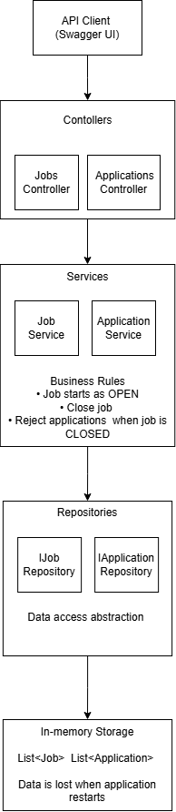

# Job Marketplace API

A backend REST API for a simplified job marketplace.

The API allows users to create and retrieve job postings, filter jobs by status, close job postings, submit job applications, and retrieve applications for a specific job.

The project focuses on separation of concerns, business logic, data-access abstraction, and testability rather than production-scale infrastructure.

## Technology Stack

* C#
* ASP.NET Core
* .NET 10
* Swagger / OpenAPI
* xUnit
* In-memory storage

## How to Run

### Prerequisites

* .NET 10 SDK
* Visual Studio Code or Visual Studio

### Run the API

1. Clone the repository.
2. Open the project folder in a terminal.
3. Restore the dependencies:

```bash
dotnet restore
```

4. Run the application:

```bash
dotnet run
```

5. Open Swagger UI using the URL shown in the terminal.

For example:

```text
http://localhost:5114/swagger/index.html
```

> The port may be different depending on the local environment.

### Run Tests

To run the unit tests:

```bash
dotnet test .\Tests\JobApi.Tests\JobApi.Tests.csproj
```

## API Endpoints

### Jobs

| Method | Endpoint               | Description                               |
| ------ | ---------------------- | ----------------------------------------- |
| POST   | `/api/Jobs`            | Create a new job                          |
| GET    | `/api/Jobs`            | Get all jobs, with optional status filter |
| GET    | `/api/Jobs/{id}`       | Get a single job                          |
| POST   | `/api/Jobs/{id}/close` | Close a job posting                       |

### Applications

| Method | Endpoint                         | Description                     |
| ------ | -------------------------------- | ------------------------------- |
| POST   | `/api/jobs/{jobId}/applications` | Submit an application for a job |
| GET    | `/api/jobs/{jobId}/applications` | Get all applications for a job  |

### Filtering Jobs

Jobs can be filtered by status using a query parameter:

```text
GET /api/Jobs?status=OPEN
```

or:

```text
GET /api/Jobs?status=CLOSED
```

The status filter is case-insensitive.

## Data Models

### Job

Each job contains:

* `Id`
* `Title`
* `Description`
* `Location`
* `CreatedDateTime`
* `Status`

### Application

Each application contains:

* `Id`
* `JobId`
* `CandidateName`
* `CandidateEmail`
* `Summary`
* `SubmittedDateTime`

`Summary` is an additional field included to provide candidates with an opportunity to briefly describe their application.

## Job Status

A newly created job is automatically assigned the `OPEN` status.

A job can be explicitly closed using the close endpoint.

Once a job is `CLOSED`, new applications are not accepted.

## Architecture

The API follows a layered architecture to separate responsibilities and make the application easier to maintain and test.

<p align="center">
  
</p>

### Layers

**API Client**

Swagger UI is used as the API client for sending HTTP requests and viewing responses.

**Controllers**

Controllers handle HTTP requests, route requests to the appropriate service, and return HTTP responses.

**Services**

Services contain the application's business logic and enforce business rules.

For example, `ApplicationService` checks whether the requested job exists and whether the job is still open before accepting an application.

**Repositories**

Repositories provide an abstraction for accessing stored data. The service layer depends on repository interfaces rather than directly accessing the underlying storage.

**In-Memory Storage**

The current repository implementations store jobs and applications using `List<Job>` and `List<Application>`.

This approach was selected because the assessment explicitly allows an in-memory or in-process store.

## Business Rules

The API implements the following business rules:

1. A newly created job starts with `OPEN` status.
2. A job can be explicitly changed to `CLOSED`.
3. A closed job cannot receive new applications.
4. An application must reference the job being applied for.
5. Jobs and applications are stored in memory while the application is running.
6. Data is lost when the application is restarted because no persistent database is used.

## Design Overview

The application separates HTTP handling, business logic, and data access into different layers:

```text
API Client
    |
    v
Controllers
    |
    v
Services
    |
    v
Repository Interfaces
    |
    v
In-Memory Repository
    |
    v
List<Job> / List<Application>
```

Dependency Injection is used to connect the interfaces to their implementations.

For example:

```text
IJobRepository
      |
      v
InMemoryJobRepository
```

and:

```text
IJobService
      |
      v
JobService
```

This means the service layer does not need to know how the data is physically stored.

The in-memory repository could therefore be replaced by a database-backed implementation in the future without requiring major changes to the controller or business logic.

## Assumptions

The following assumptions were made to keep the implementation within the scope of the assessment:

* Authentication and authorisation are not implemented because they are explicitly outside the assessment scope.
* No frontend application is included because the assessment only requires a backend API.
* An in-memory store is used instead of a database because persistent storage is not required.
* Job status is limited to `OPEN` and `CLOSED`.
* Newly created jobs are always opened automatically.
* A closed job cannot be reopened through the current API.
* Applications can only be submitted for an existing and open job.
* Candidate email is stored as provided by the client; authentication and advanced identity verification are outside the scope of this assessment.
* The API is intended to run locally and does not need to be deployed.
* Data persistence between application restarts is not required.
* Swagger/OpenAPI is used to make the API easy to exercise locally.

## Testing

The project uses xUnit for unit testing.

Key business logic covered by the tests includes:

* Creating a job with `OPEN` status.
* Closing an existing job.
* Handling attempts to close a non-existent job.
* Submitting an application to an open job.
* Preventing an application from being submitted to a closed job.

The tests focus on business logic in the service layer so that the core rules can be tested independently of the HTTP/API layer.

## What I Would Improve With More Time

If this API were developed beyond the scope of this assessment, I would consider the following improvements:

### Persistent Database

Replace the in-memory repositories with a database-backed implementation such as PostgreSQL or SQL Server.

This would allow jobs and applications to persist after the application restarts.

### Validation

Add stronger request validation, including:

* Required job title, description, and location.
* Required candidate name and email.
* Email format validation.
* Validation of supported job statuses.

### API Error Handling

Introduce consistent error responses for cases such as:

* Job not found.
* Attempting to apply to a closed job.
* Invalid request data.

A standard error response format could also be introduced.

### Improved Status Modelling

Replace string-based job statuses with an enum to prevent invalid status values and make the domain model more strongly typed.

### Additional Testing

Add more unit and integration tests covering:

* Non-existent jobs when submitting applications.
* Job status filtering.
* Retrieving applications for a job.
* Controller/API endpoint responses.
* Validation failures.

### Pagination and Sorting

For a larger number of jobs and applications, pagination and sorting could be added to avoid returning all records in a single request.

### Authentication and Authorisation

If the API became a real marketplace, authentication and authorisation would be required to control who can create, close, and manage job postings and applications.

### Logging and Monitoring

Structured logging and application monitoring could be added to help diagnose errors and understand API usage.

### CI/CD

A CI/CD pipeline could automatically build the application and execute the test suite whenever changes are pushed to the repository.

## Scope and Trade-offs

The implementation intentionally keeps the solution small and focused on the requirements of the assessment.

Rather than adding production-level infrastructure, the project prioritises:

* Clear separation of responsibilities.
* Business logic in the service layer.
* Data-access abstraction through repository interfaces.
* Simple in-memory storage.
* Testable business rules.
* A clear API structure.
* Documentation and architecture diagrams.

This keeps the solution aligned with the assessment's focus while leaving a clear path for future improvements.
